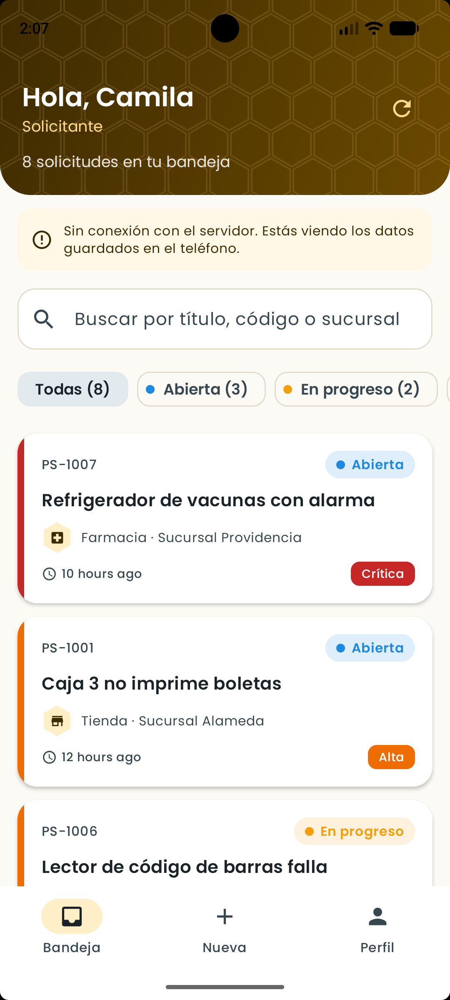
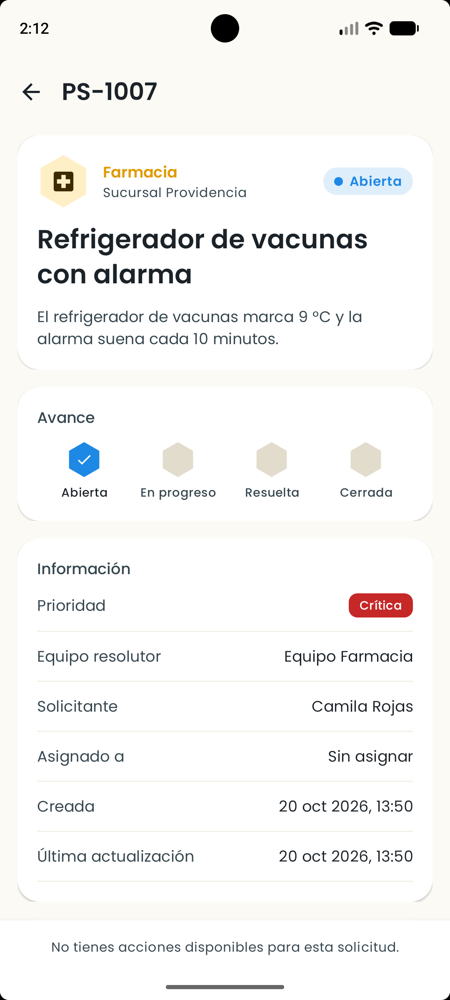
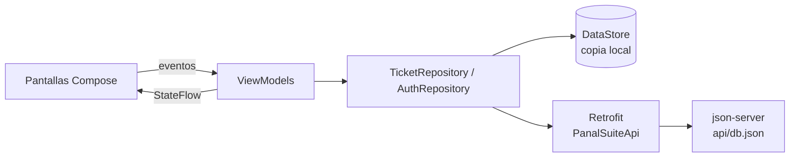
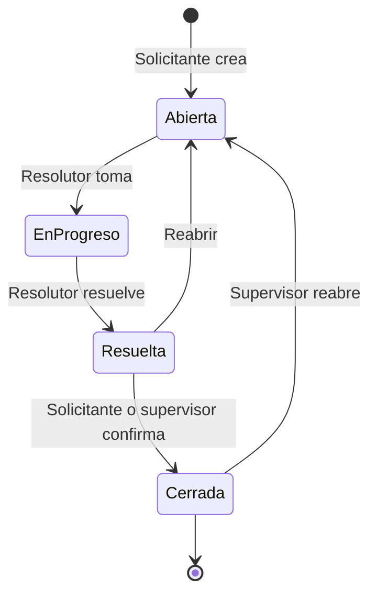

# PanalSuite

Aplicación Android para gestionar solicitudes internas (tickets) de una cadena de tiendas y farmacias: un trabajador reporta un problema desde su celular, el equipo responsable lo toma y lo resuelve, y un supervisor ve el estado general.

Proyecto del Parcial 2 de Desarrollo de Aplicaciones Móviles, Duoc UC.
Autora: Marcela Sepúlveda Huircán.

## Capturas

| Bandeja de solicitudes | Detalle de una solicitud |
|---|---|
|  |  |
| Saludo con el rol del usuario, buscador, filtros por estado y tarjetas con la prioridad en color. | Avance del estado con hexágonos, información de la solicitud e historial de cambios. |

## Funcionalidades

- **Login con validación**: formato de correo, contraseña de mínimo 8 caracteres con al menos un número, y mensajes de error en cada campo.
- **Sesión persistente**: el usuario queda guardado con DataStore y no tiene que volver a iniciar sesión al abrir la app.
- **Bandeja de solicitudes**: búsqueda, filtros por estado con contador y deslizar hacia abajo para sincronizar.
- **Nueva solicitud**: formulario validado (título, descripción, categoría, prioridad y sucursal) con contador de caracteres.
- **Detalle**: progreso del estado, información y línea de tiempo con el historial de cambios.
- **Flujo por rol**:

| Rol | Ve | Puede |
|---|---|---|
| Solicitante | Sus propias solicitudes | Crear solicitudes, cerrar o reabrir las resueltas |
| Resolutor | Las abiertas y las asignadas a él | Tomar una solicitud y marcarla como resuelta |
| Supervisor | Todas | Cerrar o reabrir, y ver el resumen general |

- **Resumen (supervisor)**: totales por estado, prioridad y categoría, y alerta de solicitudes críticas.
- **Funciona sin conexión**: si la API no responde, la app usa los datos guardados en el teléfono y sube los cambios en la siguiente sincronización.

## Diseño

- Identidad inspirada en un panal: paleta miel y café, hexágonos en íconos, avatar y pasos de progreso, y textura de panal dibujada con `Canvas`.
- Tipografía Poppins (Google Fonts, licencia OFL).
- Colores por estado (Abierta, En progreso, Resuelta, Cerrada) y franja lateral de color según la prioridad.
- Animaciones: cambio de color del estado, barras del resumen, ícono de sincronización, aparición de la barra inferior y de los mensajes de error.
- Soporte de modo oscuro.

## Arquitectura

Patrón **MVVM** con una sola fuente de datos (repositorio) y estados expuestos con `StateFlow`.



```
app/src/main/java/com/example/panalsuite
├── data
│   ├── local         # DataStore con la copia de los tickets y datos de ejemplo
│   ├── preferences   # SessionManager (sesión del usuario)
│   ├── remote        # Retrofit: ApiClient, PanalSuiteApi y DTOs
│   └── repository    # AuthRepository y TicketRepository
├── model             # Modelos y reglas de negocio por rol (TicketWorkflow)
├── ui
│   ├── components    # Componentes reutilizables (tarjeta, chips, panal)
│   ├── login, inbox, create, detail, summary, profile
│   ├── navigation    # NavHost y barra inferior según el rol
│   └── theme         # Colores, tipografía y formas
└── util              # Validaciones y formato de fechas
```

## Flujo de una solicitud



## Cómo ejecutar

1. Levantar la API (requiere Node.js):
   ```bash
   cd api
   npm install
   npm start
   ```
2. Abrir el proyecto en Android Studio y ejecutarlo en un emulador. La app se conecta a `http://10.0.2.2:3000/`, que es el `localhost` del computador visto desde el emulador.
3. Iniciar sesión con un usuario de prueba (también se pueden autocompletar desde el login):

| Rol | Correo | Contraseña |
|---|---|---|
| Solicitante | solicitante@panalsuite.test | Demo1234 |
| Resolutor | resolutor@panalsuite.test | Demo1234 |
| Supervisor | supervisor@panalsuite.test | Demo1234 |

Si la API no está corriendo, la app igual funciona con los datos guardados en el teléfono.

## Pruebas

Pruebas unitarias de validaciones (`ValidatorsTest`) y de reglas por rol (`TicketWorkflowTest`):

```bash
./gradlew test
```

## Tecnologías

Kotlin, Jetpack Compose, Material 3, Navigation Compose, ViewModel, StateFlow, DataStore, Retrofit, Gson y json-server.
